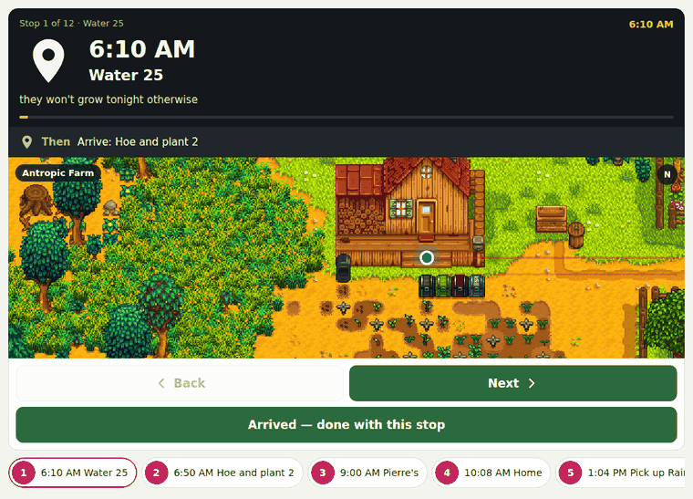
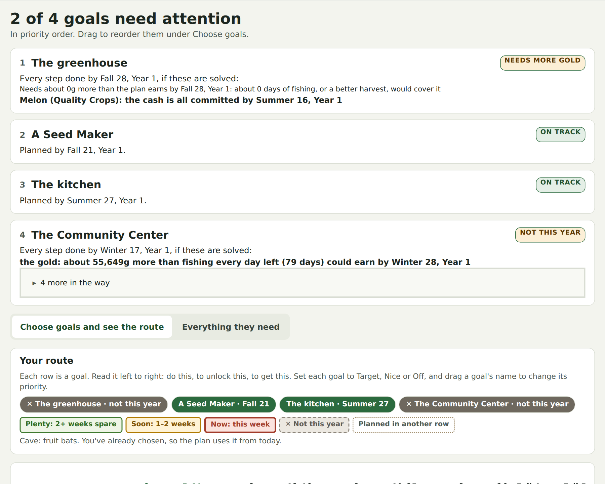
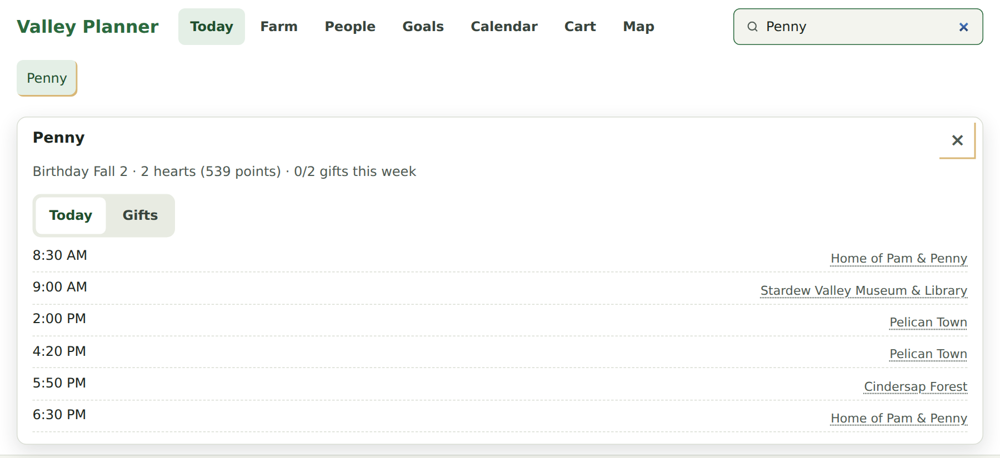
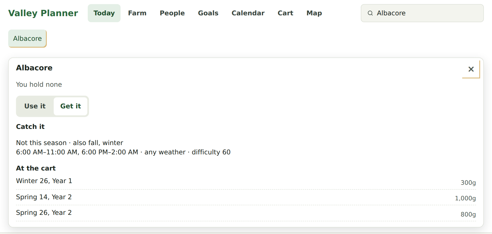
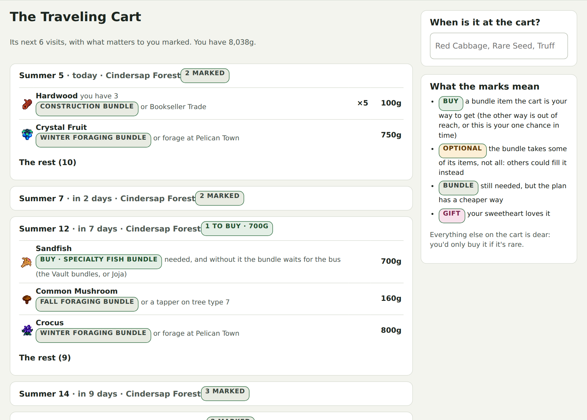
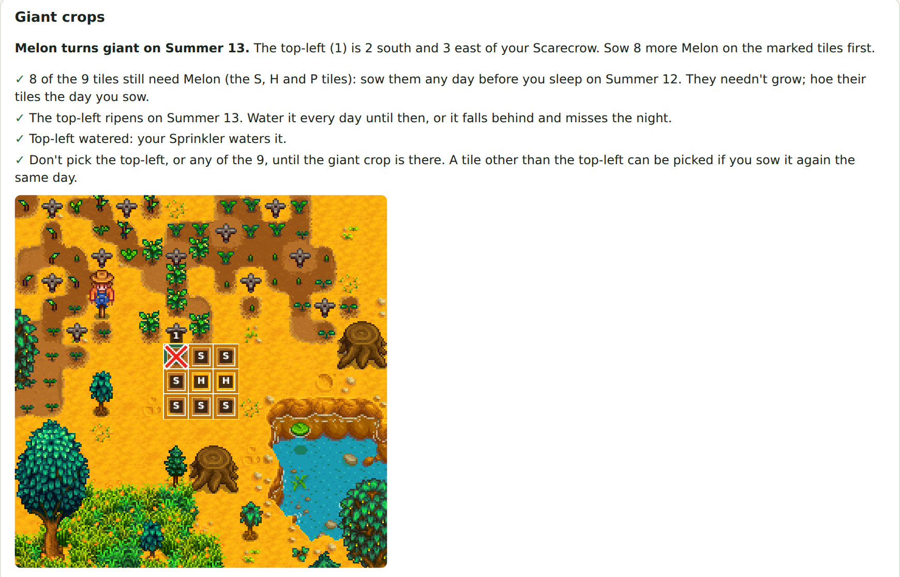
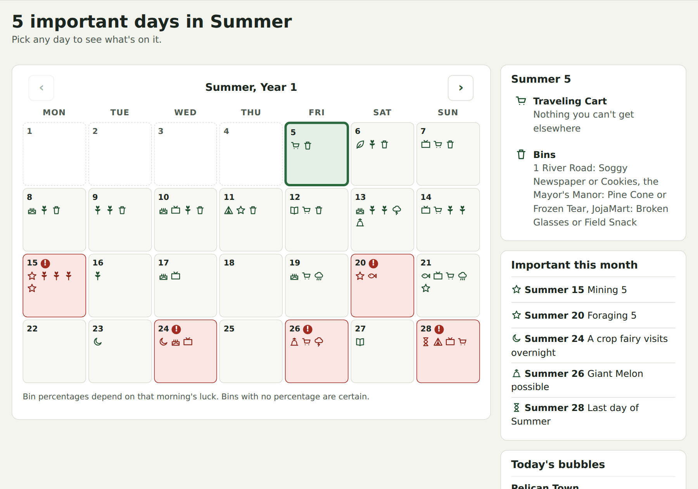
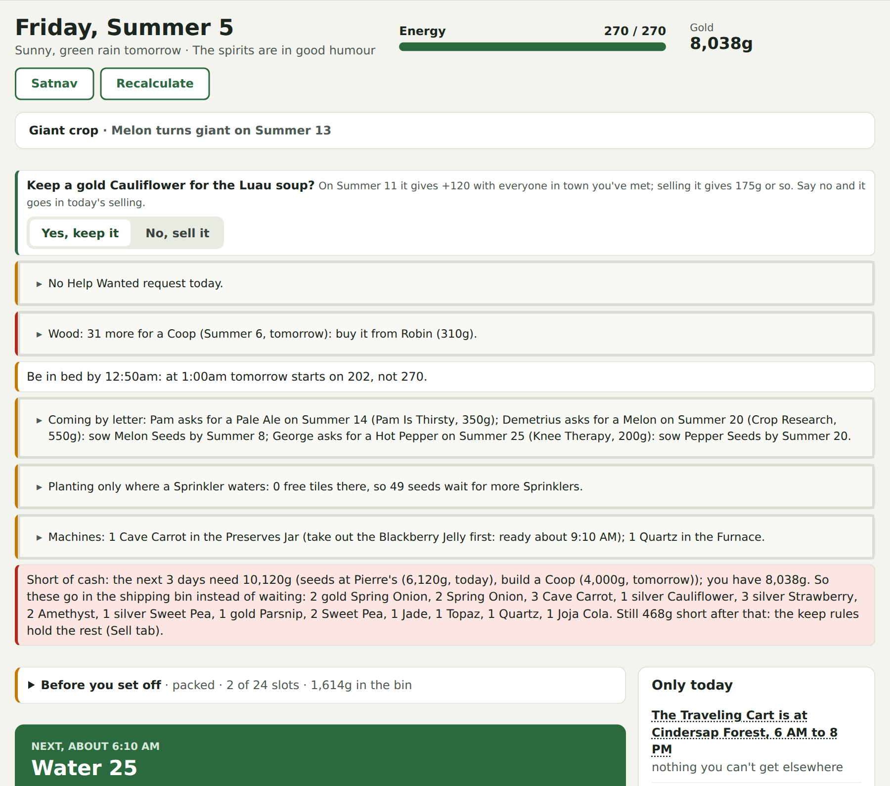
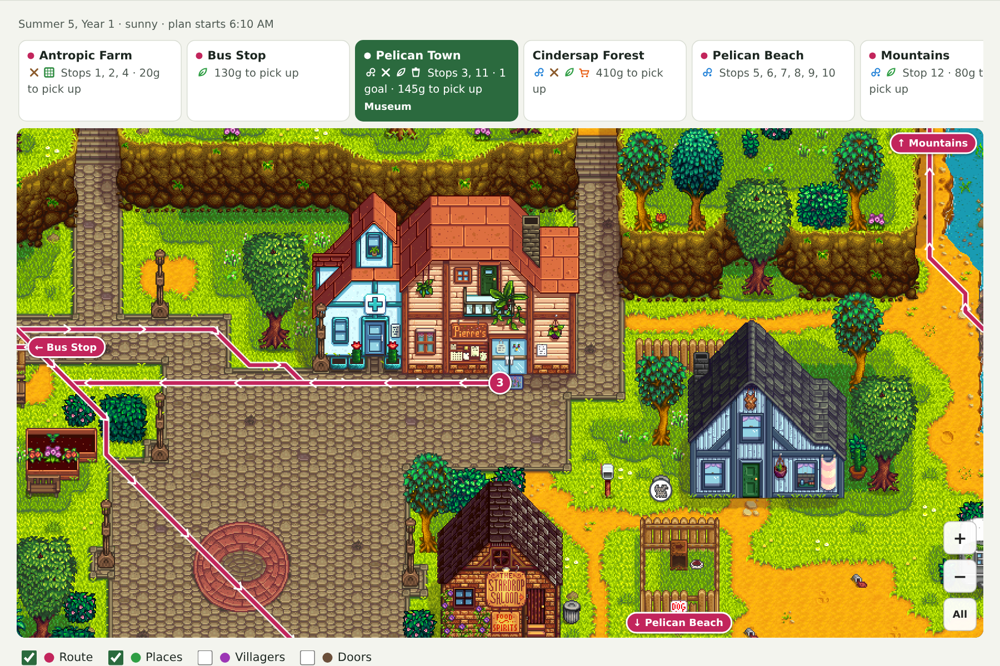
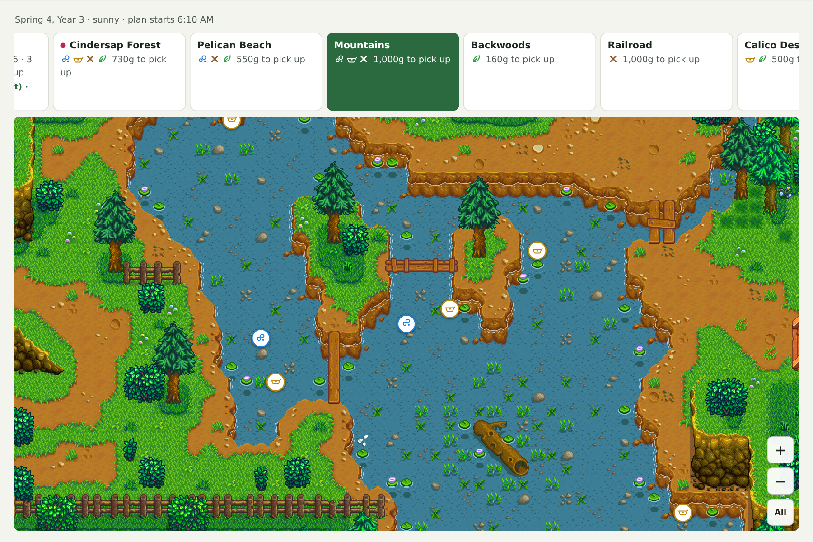

# Valley Planner

### Stardew Valley, for people who are busy.

You've got an hour before bed, not a whole evening. Valley Planner reads your save each morning and tells you
what's worth doing with today: in what order, how to walk there, and what to leave for tomorrow. It's free,
it runs on your own computer, and it never touches your game.

<p align="center">
  
</p>

**[Download for Windows](https://github.com/crypto-morph/valley-planner/releases/latest)** · or `uvx valley-planner` on
Mac and Linux · [how to install](#install)

---

## The Community Center, in record time

The main job is getting you to the Community Center unlock as fast as the game allows. Pick your goals (the
greenhouse, the kitchen, a Seed Maker, the whole Community Center) and drag them into order. The planner works
out every step to a date: what to buy, what to grow, what to keep back from the shipping bin, and where the
gold has to come from. If something can't happen this year, it says so plainly and tells you what's in the way.

Then Today turns that route into one list for this morning, timed to the clock and to your energy bar.

<p align="center">
  
</p>

## Stop living on the wiki

Everyone who plays Stardew ends up on the wiki asking "where's Penny right now?" or "I need an Albacore: where
are they?" The search box at the top of every page answers that. Type a villager, an item or a fish and get
where they are today and what they love, or where to catch it, when it bites and what it's worth.

<table>
  <tr>
    <td></td>
    <td></td>
  </tr>
</table>

## Untangle the randomness

Stardew's luck can sink a perfect run. Miss the one day the Traveling Cart brings the thing you need and the
Community Center slips into Year 2. But much of that "luck" is fixed by your save's seed, so the planner can
work it out ahead of time: the cart's stock for its next six visits, what's in the garbage cans, whether it
will rain, and what your next geodes hold. It marks the cart items your bundles need, so you know which Friday to turn up
with 700g in your pocket.

<p align="center">
  
</p>

## Your plot, sorted

Laying out a farm is either the best part of the game or a chore. If it's a chore, the planner tells you what's
still worth planting this season, the last day you can sow it, and where every crop in the ground stands. It
won't let a harvest slip past.

It even knows the magic of giant melons. It finds the 3×3 squares that will grow one, tells you which tiles to
sow and which one to keep watered, and gives you the day the giant appears.

<p align="center">
  
</p>

## Never miss a thing

Birthdays, festivals, skill levels, the night a crop fairy visits, the last day of the season: it's all on one
calendar, with the days that matter flagged in red. Each morning, Today also warns you about anything rare in
the ground. If a Lost Book or a Prismatic Shard is buried with the worms, it tells you, and puts it on your
route.

<p align="center">
  
</p>

## A morning briefing that thinks ahead

Today puts the decisions up top. Keep that gold Cauliflower for the Luau soup or sell it? You're short of cash
for tomorrow's Coop, so here's what to ship. Be in bed by 12:50am or tomorrow starts tired. Then comes the day's
plan, stop by stop, with a Satnav button that turns it into directions.

<p align="center">
  
</p>

## The map knows where to look

The Map draws the day's route over the real game map, built from your own copy of the game. It shows
where to fish, where to forage, which artifact spots to dig, and which bins are worth a look. It also works out
where the fishing bubbles will appear and when, so you can be standing there when they do.

<p align="center">
  
</p>

Once you've got the Copper Pan, it does the same for panning: every spot where ore will shimmer in the water
that day, on every map, with the times. (The forecast holds until you pan one; after that, that map's later
spots move.)

<p align="center">
  
</p>

---

## Your game, your data

- **Nothing from the game ships with Valley Planner.** On first run it reads the game data it needs (crops,
  prices, shops, schedules, maps) from **your own installed copy**, and keeps the result in a local cache.
- **Your save never leaves your computer.** There's no server and no upload.
- **Vanilla.** No mods needed. It only ever reads your saves; it never changes them.

## Install

**Windows:** download `valley-planner.exe` from the
[latest release](https://github.com/crypto-morph/valley-planner/releases/latest) and double-click it. A small window
shows where it's running and the planner opens in your browser; close that window to stop it. The first time,
Windows may warn about an unrecognised app because it isn't signed: choose "More info", then "Run anyway".

**Mac, Linux and WSL, with [uv](https://docs.astral.sh/uv/):**

```bash
uvx valley-planner
```

It finds Steam (any library folder) and GOG installs, and your saves, on its own. If yours are somewhere unusual,
set `VALLEY_PLANNER_GAME` to the install folder or `VALLEY_PLANNER_SAVES` to the `Saves` folder.
`valley-planner --check` shows what it found.

Your to-do lists are kept in your own data folder (`%LOCALAPPDATA%\ValleyPlanner` on Windows,
`~/.local/share/valley-planner` on Linux), and the decoded game data is cached per game version.

## Using it while you play

Stardew only saves when you sleep, so the planner always shows the *morning* of the day you're on. Play a day,
go to bed, refresh the page.

Follow the plan, or tick what you've done, enter the time, your energy and where you are, and press
**Recalculate**. Recalculating also teaches it how fast you walk.

Predictions for days ahead are as exact as the game allows. The cart's stock and rain or shine are fixed by the
seed. Garbage cans are shown as odds, because they depend on that morning's luck.

## Development

```bash
uv sync
uv run pytest           # tests that need the game are skipped when it isn't installed
uv run ruff check .
uv run valley-planner --dev   # http://127.0.0.1:8765, restarts when the Python changes
```

The page, script and styles are read from disk on every request, so a browser refresh shows those changes.

A Windows `.exe` is built only when asked for: run the CI workflow by hand (Actions → CI → Run workflow, or
`gh workflow run ci.yml`) and download `valley-planner-windows` from that run. Pushing a `v*` tag builds the `.exe`
and the Python package and attaches them to a GitHub release (a tag with a suffix, like `v0.1.0-beta.2`, is
published as a pre-release).

Rules the planner relies on are checked against the game's own behaviour, and each is described in our own words;
no game code, text or files are kept in this repository.

## Licence

[MIT](LICENSE).

> Valley Planner is a fan-made tool. It is **not affiliated with or endorsed by ConcernedApe**.
> Stardew Valley® is a trademark of ConcernedApe LLC. Screenshots are from real saves; the map art in them is
> drawn from the player's own copy of the game.
